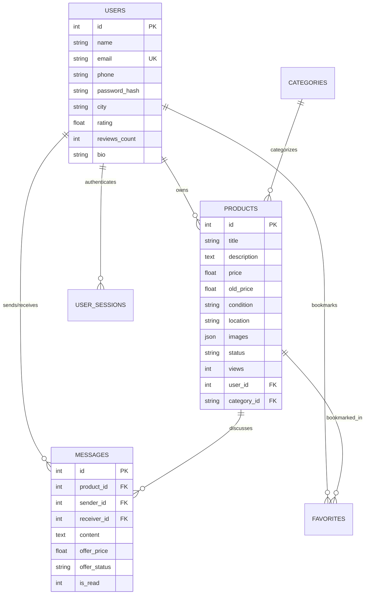

# 🚀 Sell Zone • Full-Stack İkinci El & Sıfır Pazaryeri

[](https://nodejs.org/)
[](https://expressjs.com/)
[](https://nodejs.org/api/sqlite.html)
[](./LICENSE)
[](./)

> **Sell Zone**, kullanıcıların elektronikten ev eşyasına, alet edevattan vasıtaya kadar her şeyi saniyeler içinde ilana koyup satabildiği, alıcı ve satıcıların anlık olarak mesajlaşıp **pazarlık teklifleri** yapabildiği, modern ve hafif mimarili tam donanımlı bir **Full-Stack C2C Pazaryeri Web Uygulamasıdır**.
> 
> *Bu proje yazılım mühendisliği portföyü ve açık kaynak vitrini (CV Showcase) amacıyla geliştirilmiştir.*

---

## 🌟 Öne Çıkan Temel Yetenekler & Özellikler

### 1. 💬 Anlık Mesajlaşma & Fiyat Teklifi / Pazarlık Motoru
- **Pazarlık Teklifleri (`offer_price`):** Alıcılar tek tıkla yüzde indirimli veya özel tutarlı teklif gönderebilir.
- **Kabul / Red Sistemi:** Satıcı teklifi doğrudan sohbet penceresinden kabul edebilir veya reddedebilir.
- **Canlı Bildirim Sayaçları:** Header ve mobil alt barda periyodik olarak senkronize olan okunmamış mesaj rozetleri.

### 2. 📦 İlan Yönetimi & İlanlarım ("My Listings")
- **Tek Noktadan Kontrol:** Kullanıcının aktif ve satılan tüm ilanlarını listeleyen profil çekmecesi.
- **İlan Düzenleme:** Başlık, kategori, fiyat, durum, şehir/ilçe ve açıklama güncelleme.
- **"Fiyatı Düştü" Rozeti:** İlan fiyatı düşürüldüğünde eski fiyatın üstü çizilir ve kartta indirim etiketi gösterilir.
- **"SATILDI" Durumu:** Satılan ürünlerde `SATILDI` damgası görüntülenir, alıcı teklif ve mesajlaşma butonları otomatik kapatılır.

### 3. 🔍 Akıllı Filtreleme & 81 İl - İlçe Kademeli Seçim
- **Kademeli İl & İlçe:** Türkiye'nin tüm illeri ve ilçelerini içeren ilişkisel seçim mekanizması.
- **Çoklu Filtreler:** Kategori, il/ilçe, fiyat aralığı (Min - Max) ve kullanım durumu (Sıfır, Yeni Gibi, İyi Durumda vb.).
- **Dinamik Arama:** İlan başlık ve açıklamalarında harf duyarsız canlı arama.

### 4. 🔐 Güvenlik, Kimlik Doğrulama & Bot Koruması
- **Şifreleme:** Güvenli ve modern tuzlanmış `crypto.scrypt` şifre hashleme algoritması.
- **E-Posta OTP Doğrulaması:** 6 haneli doğrulama kodu akışı (SMTP tanımlanmadığında otomatik simülasyon ve test modu).
- **Şifremi Unuttum:** E-posta adresine tek kullanımlık şifre sıfırlama kodu ile güvenli hesap kurtarma.
- **Cloudflare Turnstile:** Bot ve DDoS saldırılarına karşı entegre Turnstile koruması.
- **Backdrop & Modal Koruması:** Form doldurulurken dışarıya kazara tıklamada veri kaybını engelleyen modal kilidi.

### 5. 🎨 Modern Glassmorphism & Mobil Uyumlu UI
- Harici ağır UI kütüphaneleri (Bootstrap/Tailwind) olmadan saf **Vanilla CSS** ile yazılmış buzlu cam (Glassmorphism) arayüzü.
- Mobil cihazlar için native hissettiren **Bottom Navigation Bar** ve dokunmatik uyumlu menüler.

---

## 🛠️ Mimari & Teknoloji Yığını (Tech Stack)

| Katman | Teknoloji | Açıklama |
| :--- | :--- | :--- |
| **Backend** | **Node.js (>=22)** & **Express.js 5** | Yüksek performanslı asenkron REST API sunucusu |
| **Veritabanı** | **`node:sqlite` (DatabaseSync)** | Node.js yerleşik SQLite motoru (Ek C++ binary derleme gerektirmez) |
| **Frontend** | **Vanilla JavaScript (ES6+ SPA)** | Sıfır bundle boyutu, framework bağımsız, ultra hızlı DOM manipülasyonu |
| **Stil & Arayüz** | **Modern CSS3 (Flexbox, Grid, CSS Variables)** | Glassmorphism, akrilik kartlar, dinamik temalar ve animasyonlar |
| **Güvenlik** | **Cloudflare Turnstile & Node Crypto** | Bot koruması, CSRF / XSS önlemleri ve scrypt hashleme |
| **Medya** | **Multer** | Ürün fotoğrafları yükleme ve doğrulama |
| **E-Posta** | **Nodemailer** | SMTP tabanlı HTML e-posta & simülasyon fallback |

---

## ⚡ Hızlı Başlangıç (Kurulum)

Projeyi yerel bilgisayarınızda çalıştırmak için aşağıdaki adımları izleyin:

### Gereksinimler
- **Node.js**: v22.0.0 veya daha yeni bir sürüm (Yerleşik `node:sqlite` desteği için gereklidir).
- **npm**: Node.js ile birlikte gelir.

### 1. Depoyu Klonlayın
```bash
git clone https://github.com/osmankaan-creator/sellzone.git
cd sellzone
```

### 2. Bağımlılıkları Yükleyin
```bash
npm install
```

### 3. Ortam Değişkenlerini Ayarlayın (İsteğe Bağlı)
Varsayılan ayarlarla doğrudan çalışabilir. SMTP veya Cloudflare eklemek isterseniz `.env` oluşturabilirsiniz:
```bash
cp .env.example .env
```

### 4. Sunucuyu Başlatın
```bash
npm start
```
*(Geliştirme modunda dosyaları izleyerek yeniden başlatmak için `npm run dev` kullanabilirsiniz).*

Tarayıcınızda açın:
👉 **`http://localhost:3000`**

---

## 🧪 Portföy İncelemesi & Demo Hesaplar (1 Tıkla Giriş)

İnceleme yapan İK uzmanları ve yazılım liderlerinin kayıt formuyla uğraşmaması için sistemde hazır 4 adet gerçekçi demo satıcı profili bulunur:

| Demo Kullanıcı | E-Posta | Konum | İlan Türleri |
| :--- | :--- | :--- | :--- |
| **Ahmet Yılmaz** | `ahmet@alsat.com` | İstanbul, Kadıköy | Bosch Şarjlı Matkap, Apple Watch, Sony Kulaklık |
| **Zeynep Kaya** | `zeynep@alsat.com` | Ankara, Çankaya | iPhone 14 Pro, Dyson V15 Süpürge, Canon EOS R6 |
| **Murat Demir** | `murat@alsat.com` | İzmir, Karşıyaka | Specialized Dağ Bisikleti, Fender Elektro Gitar |
| **Elif Çelik** | `elif@alsat.com` | Bursa, Nilüfer | İskandinav Berjer, Thule Araç Bagajı |

> 💡 **Nasıl Test Edilir?**
> Sayfa açıldığında giriş yap butonuna tıklayın ve modal içerisindeki **"Demo Girişi"** kutusundan dilediğiniz kullanıcıya tıklayın. Şifre girmeden anında oturum açabilir, diğer satıcılara mesaj ve teklif gönderebilir, ürün düzenleyebilir veya yeni ilan oluşturabilirsiniz.

---

## 📂 Dizin Yapısı

```
sellzone/
├── data/                       # Veritabanı dizini (.gitignore ile korunur)
│   └── .gitkeep
├── public/                     # Statik frontend dosyaları (SPA)
│   ├── app.js                  # Frontend iş mantığı, DOM yönetimi ve API istemcisi
│   ├── index.html              # Modern semantik HTML5 iskeleti ve modallar
│   ├── style.css               # Kapsamlı Glassmorphism ve responsive CSS sistemi
│   └── uploads/                # Yüklenen ürün fotoğrafları
├── .env.example                # Örnek ortam değişkenleri şablonu
├── .gitignore                  # Gizli dosyalar ve veritabanı yoksayma listesi
├── database.js                 # SQLite şeması, tablolar, indeksler ve otomatik seed verileri
├── mailer.js                   # E-posta OTP & şifre sıfırlama modülü (SMTP & simülasyon)
├── server.js                   # Express REST API uç noktaları, oturum & yetkilendirme
├── LICENSE                     # MIT Açık Kaynak Lisansı
└── package.json                # Proje yapılandırması ve bağımlılıklar
```

---

## 📄 Veritabanı Şeması



---

## 📜 Lisans

Bu proje [MIT Lisansı](./LICENSE) kapsamında açık kaynak olarak sunulmaktadır.
Dilediğiniz gibi inceleyebilir, fork'layabilir veya portföy projelerinizde referans olarak kullanabilirsiniz.
